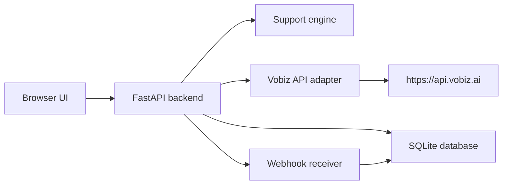

# VobiAssist

VobiAssist is a local, developer-focused support application for Vobiz API troubleshooting, telephony diagnostics, and webhook handling. The project is designed for a product support engineering interview and a practical local demo: it combines a FastAPI backend with a browser-based dashboard, a rule-based assistant, a call monitor, and a webhook lab while keeping credentials off the frontend and disabled by default for any real call flow.

## Why this project is relevant to Vobiz

The application specifically models the Vobiz developer workflow:

- authentication via `X-Auth-ID` and `X-Auth-Token`
- read-only account connectivity checks
- outbound call troubleshooting
- SIP and RTP diagnostics
- webhook duplicate detection and validation
- local developer support around rate limits and account restrictions

The app is intentionally designed to be safe for local development: it does not place a real call automatically, and it never exposes account secrets in the browser or source control.

## System architecture



## Features

- FastAPI health and configuration endpoints
- Rule-based troubleshooting assistant for common Vobiz support issues
- Safe connectivity testing of Vobiz endpoints using backend credentials
- Call log persistence and masked phone numbers
- Webhook receipt with duplicate detection and idempotent processing
- Local configuration and settings overview
- Frontend dashboard with overview, API explorer, monitor, and support tools
- Automated backend tests for the main app behaviors

## Local setup for Windows PowerShell

```powershell
cd C:\Users\kanda\VobiAssist
python -m venv .venv
.\.venv\Scripts\Activate.ps1
cd backend
pip install -r requirements.txt
Copy-Item ..\.env.example ..\.env
```

Then edit `.env` and fill in the values you need. Do not commit the real `.env` file.

## Configuration

Use a backend `.env` file with values such as:

```env
VOBIZ_AUTH_ID=
VOBIZ_AUTH_TOKEN=
VOBIZ_BASE_URL=https://api.vobiz.ai
ENABLE_REAL_CALLS=false
AI_PROVIDER=rules
OLLAMA_BASE_URL=http://localhost:11434
OLLAMA_MODEL=
DATABASE_URL=sqlite:///./vobiassist.db
FRONTEND_ORIGIN=http://localhost:5173
APP_VERSION=0.1.0
```

## Run the backend

```powershell
cd C:\Users\kanda\VobiAssist\backend
. ..\.venv\Scripts\Activate.ps1
uvicorn app.main:app --reload --host 0.0.0.0 --port 8000
```

## Run the frontend

```powershell
cd C:\Users\kanda\VobiAssist\frontend
npm install
npm run dev -- --host 0.0.0.0 --port 5173
```

## Run the tests

```powershell
cd C:\Users\kanda\VobiAssist\backend
pytest -q
```

## How to use the app in mock mode

- Start the backend and frontend locally.
- Use the AI support assistant in text mode.
- Use the Webhook Lab to send duplicate or repeated deliveries.
- Use the call monitor to inspect local simulated records.
- Validate the Vobiz connectivity endpoint, but keep real call creation disabled by default.

## How to verify real Vobiz connectivity

1. Add valid `VOBIZ_AUTH_ID` and `VOBIZ_AUTH_TOKEN` to `.env`.
2. Start the backend.
3. Open the API Explorer and run the connection test.
4. Confirm the result and check whether the request is accepted or rejected with an auth or permission error.
5. Only enable real calls if you are certain the account can support the action and you want to make a billable test call.

> Real webhook delivery requires a reachable public endpoint or a supported tunnel. Local development cannot receive externally initiated Vobiz callbacks without network exposure.

## How to use Postman

Import the collection from [postman/vobiassist.postman_collection.json](postman/vobiassist.postman_collection.json). Then:

- hit the health endpoint
- test the chat assistant
- run the connectivity endpoint
- submit a webhook payload to the local receiver

## Mock versus real behavior

This project intentionally distinguishes between local simulation and real Vobiz integration:

- Local demo data is clearly labeled as simulation.
- Real calls remain disabled until explicit user confirmation and local config enablement.
- The Vobiz adapter is a safe read-only connector and does not proxy arbitrary external requests.
- Webhook delivery is idempotent and checks for duplicate `event_id` values.

## Known limitations and future improvements

- The app is intentionally local-first and does not require paid AI services.
- Ollama support is optional and automatically falls back to the rule-based engine when unavailable.
- The Vobiz docs are static at implementation time; real provider behavior depends on account permissions, token validity, and your network setup.
- A production deployment would need stricter auth, observability, and public webhook hosting.

## Additional project files

- [TECH_STACK.md](TECH_STACK.md)
- [.env.example](.env.example)
- [.gitignore](.gitignore)
- [postman/vobiassist.postman_collection.json](postman/vobiassist.postman_collection.json)
